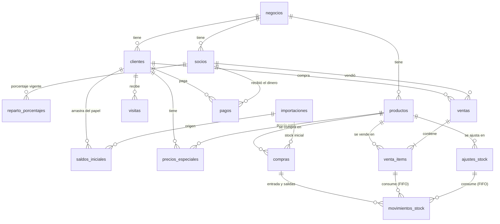

# Plan del sistema de gestión — Versión 2

> Estado: **borrador para aprobar**. Incorpora las respuestas definitivas de los socios
> a las 15 preguntas de la versión 1. Donde la versión 1 decía otra cosa, manda esta.
> No se programa nada hasta que este plan esté aprobado.

Índice:
1. Objetivo y alcance
2. Decisiones de negocio (definitivas)
3. Ambigüedades técnicas resueltas (propuestas documentadas)
4. Modelo de datos y relaciones
5. Reglas de cálculo
6. Ejemplos numéricos
7. Verificación: capital invertido vs. ganancia
8. Contradicciones y tensiones detectadas
9. Arquitectura
10. Pruebas propuestas
11. Plan de implementación por módulos

---

## 1. Objetivo y alcance

MVP simple, confiable y práctico para el trabajo diario de dos socios. Sin complejidad contable
que no aporte valor real. App web **solo online**, responsive: cómoda en celular y en una
computadora con Windows.

### Etapa 1 (este plan la detalla)
Clientes con visitas básicas y atrasados · productos y compras con costo FIFO · ventas con varios
productos · precios generales y especiales · pagos y cuenta corriente · ganancia con reparto 50/50
configurable · ajustes de stock · anulaciones · medios de pago · responsables de cada operación ·
carga inicial por planilla CSV.

### Etapa 2 (solo se deja el modelo preparado, no se programa)
Historial de visitas y recordatorios · devoluciones y reposiciones por productos fallados ·
retiros por socio.

### Fuera de alcance
Modo offline y sincronización, mapas, proveedores, gastos, finanzas avanzadas, productos que no
sean vapers (la estructura queda preparada, nada más).

### Reglas de implementación (resumen)
UUID generados en el cliente · operaciones idempotentes · inventario solo por movimientos ·
precios y costos históricos congelados · nada financiero ni de inventario se borra (se anula) ·
ventas, cobros, deudas, costos, ganancias y retiros separados · ramas, un módulo por vez,
pruebas obligatorias de dinero e inventario.

---

## 2. Decisiones de negocio (definitivas)

| # | Tema | Decisión |
|---|------|----------|
| 1 | Costo | **FIFO automático.** Al vender, el sistema consume las compras más antiguas del producto. No se elige lote. Cada compra registra producto, cantidad, costo unitario, fecha y costo total. El costo de una venta, una vez registrado, no cambia nunca. |
| 2 | Ganancia | Ganancia = importe de venta − costo FIFO de lo vendido. **No** hay ganancia proporcional a lo cobrado. Cada venta muestra: importe, costo, ganancia, cobrado y saldo. |
| 3 | Cuenta corriente | Cada pago se carga a cuenta del cliente y se aplica **solo** a las deudas más viejas (FIFO). Pagos parciales permitidos. Lo que sobra queda como **saldo a favor**. |
| 4 | Reparto | Primero se descuenta el costo; la ganancia se divide según el porcentaje (50/50 por defecto, configurable). Se muestra ganancia total, parte de cada socio, ganancia acumulada y dinero cobrado, **por separado**. No se distribuye dinero: solo se informa. |
| 5 | Pérdidas | Etapa 1: ajuste de stock con motivo (regalo, pérdida, rotura); descuenta stock por FIFO, registra su costo y **ese costo resta de la ganancia**. Etapa 2: devoluciones/reposiciones. |
| 6 | Anulaciones | Ventas, pagos, compras, ajustes y movimientos nunca se borran. Se anulan con registros compensatorios. |
| 7 | Ventas | Una venta tiene varios renglones (producto, cantidad, precio). El total se calcula solo. |
| 8 | Precios | Precio general por producto + precio especial por cliente y producto. Precio propuesto: especial del cliente → último precio que pagó ese cliente por ese producto → general. Siempre editable. Se guarda el precio histórico. |
| 9 | Pagos | Medios: efectivo, transferencia, Mercado Pago. Cada pago: cliente, importe, fecha, medio, usuario que lo registró y socio que recibió el dinero. |
| 10 | Visitas | Última visita = la más reciente entre ventas y "marcar como visitado". Intervalo en días (14 por defecto). Próxima visita = última + intervalo. **Atrasado desde el día siguiente** a la fecha prevista. Clientes archivables sin perder historial. |
| 11 | Productos | Producto = marca + puffs + sabor. Catálogo con marca, modelo/puffs, sabor, stock, costo y precio general. Solo vapers por ahora; estructura preparada para otras categorías. |
| 12 | Responsables | Se registra quién hizo cada venta, quién registró cada pago, quién recibió el dinero y quién cargó cada compra o ajuste. |
| 13 | Carga inicial | ~100 clientes, ~700 unidades en stock (+400 que llegan como compra nueva), deudas, saldos a favor, precios generales y especiales. Importación CSV en Etapa 1 con pantalla de verificación de totales antes de confirmar. No se inventan datos faltantes. |
| 14 | Login | Email y contraseña, sesión persistente y segura, un acceso por socio. |
| 15 | Cuentas | GitHub, Supabase y Netlify a nombre de Benjamín; luego se da acceso de administrador al papá. Ninguna clave en el código ni en el frontend. |

---

## 3. Ambigüedades técnicas resueltas (propuestas documentadas)

No son preguntas: son soluciones simples que propongo. Si alguna no les sirve, se cambia antes de programar.

**A1. Socio ≠ usuario de login.** Hoy solo Benjamín tiene cuenta; el papá la tendrá después. Pero el
papá ya vende y ya recibe plata. Por eso:
- `socios` es una tabla propia (nombre, porcentaje) con un `user_id` **opcional**.
- "Quién recibió el dinero" y "quién hizo la venta" apuntan a un **socio**.
- "Quién registró" apunta al **usuario logueado** (auditoría automática, no se elige).
- Por defecto, el socio de la venta/pago es el del usuario logueado; se puede cambiar con un toque.

**A2. Orden FIFO.** Las compras se consumen por `fecha de compra` y, a igual fecha, por orden de carga.
El costo se asigna **en el momento de registrar** la venta o el ajuste y queda congelado. Si después se
carga una compra con fecha anterior, **no** se recalculan costos pasados (requisito: el costo histórico
no cambia retroactivamente).

**A3. Fecha de las operaciones.** Por defecto es "ahora". Se puede poner una fecha pasada (para cargar
algo de ayer), nunca futura. La fecha afecta reportes por período, visitas y el orden de aplicación de
pagos; **no** cambia el costo FIFO ya asignado (A2).

**A4. Aplicación de pagos (FIFO) se calcula, no se guarda.** Se suman todos los créditos del cliente
(pagos + saldo inicial a favor) y se van cubriendo las deudas de la más vieja a la más nueva. Ventajas:
- Si se anula un pago o una venta, todo se reacomoda solo y de forma coherente.
- El resultado no depende del orden en que se cargaron los pagos (solo del total).
- Los pagos y las ventas en sí nunca cambian; lo que cambia es la distribución mostrada.

**A5. Deudas y saldos a favor iniciales.** Las deudas que vienen del papel **no son ventas del sistema**:
no tienen costo conocido, así que no generan ganancia (no se inventan datos). Se guardan como
"saldo inicial" del cliente: participan de la cuenta corriente (son la deuda más vieja) pero no de
ventas ni de ganancia. Lo que se cobre de ellas cuenta como **dinero cobrado**, no como ganancia.

**A6. Stock inicial.** Las ~700 unidades se cargan como una compra especial "inventario inicial" por
producto (marca + puffs + sabor), con su costo unitario real. Las 400 que llegan se cargan como compra
normal.

**A7. Costo total de una compra.** Se guarda `costo_unitario` en centavos; `costo_total = cantidad ×
costo_unitario`. Si se ingresa el total y no divide exacto (ej. $100.000 / 3), se redondea el unitario
al centavo y la pantalla muestra la diferencia (como máximo unos centavos) antes de confirmar.

**A8. Reparto con porcentaje configurable.** Se guarda el porcentaje con fecha de vigencia. Cada venta y
cada ajuste usan el porcentaje vigente en su fecha. Cambiar el porcentaje no reescribe el pasado.
Redondeo: cada parte se calcula en centavos hacia abajo y el centavo sobrante (si hay) va al primer socio
de la lista, para que la suma de las partes sea **exactamente** la ganancia.

**A9. Ajustes de stock en Etapa 1** son solo de salida (regalo, pérdida, rotura). Un error de carga en una
compra se corrige anulándola (posible solo si todavía no se vendió nada de esa compra) y cargándola de
nuevo. No agrego ajustes de entrada porque requerirían inventar un costo.

**A10. Costo en el catálogo.** Con FIFO no hay "un" costo por producto. El catálogo muestra el **costo de la
próxima unidad a vender** (la compra más vieja con stock) y el **valor del stock a costo** (suma de lo que
queda de cada compra). Este último es justamente el capital invertido en mercadería (ver sección 7).

**A11. Stock insuficiente y concurrencia.** No se puede vender ni ajustar más de lo disponible. Si los dos
socios venden la última unidad al mismo tiempo, la base serializa las operaciones (bloqueo de filas en la
transacción) y la segunda recibe "sin stock".

**A12. Visitas de Etapa 1 guardadas como eventos.** "Marcar como visitado" inserta un registro en `visitas`
en lugar de pisar un campo. Es igual de simple, no pierde datos y deja listo el historial de Etapa 2
(que solo agrega pantallas).

**A13. Cliente sin ventas ni visitas.** Su próxima visita se calcula desde la fecha de alta (o la fecha de
última visita que venga en el CSV, si viene).

**A14. Clientes archivados.** No aparecen en búsqueda ni en atrasados; **sí** siguen apareciendo en "quién
debe plata" si tienen deuda (la deuda no desaparece por archivar). Se pueden desarchivar.

**A15. Anular una venta ya cobrada.** Los pagos no se tocan; el crédito se reaplica a otras deudas o queda
como saldo a favor (consecuencia directa de A4).

**A16. Importación CSV.** Planillas separadas y en orden: productos → clientes → stock inicial → precios
especiales → saldos iniciales. Las referencias se hacen por nombre exacto (cliente) y por
marca+puffs+sabor (producto); si algo no coincide o es ambiguo, la fila se marca con error y **no** se
importa nada hasta corregirla. Cada importación tiene un UUID: confirmarla dos veces no duplica. La
pantalla previa muestra cantidad de filas y totales (unidades, valor del stock a costo, total de deudas,
total de saldos a favor) para compararlos con el papel.

---

## 4. Modelo de datos y relaciones

### 4.1 Principios
- Dinero en **centavos (`bigint`)**. $12.345,50 = `1234550`.
- **UUID generado en el cliente** en ventas, renglones, pagos, compras, ajustes, visitas, saldos
  iniciales e importaciones. Las funciones de escritura son idempotentes por ese UUID.
- **Inmutabilidad**: las tablas de operaciones solo aceptan inserciones; la anulación se registra con
  columnas `anulado_en / anulado_por / motivo_anulacion` y, cuando corresponde, movimientos compensatorios.
- Todo tiene `negocio_id` (para RLS), `registrado_por` (usuario) y `creado_en` (hora del servidor).

### 4.2 Diagrama de relaciones



### 4.3 Tablas (Etapa 1)

```
negocios
  id uuid PK · nombre · creado_en

socios                                  -- también define quién tiene acceso (RLS)
  id uuid PK · negocio_id FK
  nombre text                           -- "Papá", "Benjamín"
  user_id uuid NULL UNIQUE FK auth.users  -- NULL hasta que el socio tenga cuenta
  orden int                             -- para el desempate de redondeo (A8)

reparto_porcentajes                     -- A8
  id uuid PK · negocio_id · socio_id FK
  porcentaje numeric(5,2) CHECK 0..100
  vigente_desde date
  -- validación en la función que lo carga: para cada vigente_desde, la suma = 100

clientes
  id uuid PK · negocio_id
  nombre text NOT NULL · telefono · notas
  intervalo_visita_dias int NOT NULL DEFAULT 14 CHECK > 0
  archivado_en timestamptz NULL         -- A14
  registrado_por · creado_en

visitas                                 -- A12 (solo "marcar como visitado"; las ventas cuentan aparte)
  id uuid PK · negocio_id · cliente_id FK
  fecha timestamptz · nota
  registrado_por · creado_en

productos
  id uuid PK · negocio_id
  categoria text NOT NULL DEFAULT 'vaper'  -- preparado para otros productos; hoy siempre 'vaper'
  marca text NOT NULL
  puffs int NULL                        -- obligatorio en la UI para vapers; NULL para futuras categorías
  sabor text NOT NULL
  precio_general bigint NULL CHECK >= 0
  activo boolean DEFAULT true
  UNIQUE (negocio_id, categoria, marca, puffs, sabor)

precios_especiales                      -- precio vigente, no histórico (lo histórico está en venta_items)
  negocio_id · cliente_id FK · producto_id FK
  precio bigint CHECK >= 0
  actualizado_por · actualizado_en
  PK (cliente_id, producto_id)

compras                                 -- cada compra = un "lote" para FIFO
  id uuid PK · negocio_id · producto_id FK
  fecha date
  cantidad int CHECK > 0
  costo_unitario bigint CHECK >= 0
  costo_total bigint GENERATED (cantidad * costo_unitario)
  origen text CHECK IN ('compra','inventario_inicial')
  importacion_id uuid NULL FK
  nota
  anulado_en · anulado_por · motivo_anulacion
  registrado_por · creado_en

movimientos_stock                       -- ÚNICA fuente de verdad del stock
  id uuid PK · negocio_id
  compra_id FK                          -- de qué compra entra o sale
  producto_id FK                        -- copia, para consultas rápidas
  tipo text CHECK IN ('compra','venta','ajuste',
                      'anulacion_compra','anulacion_venta','anulacion_ajuste')
  cantidad int CHECK <> 0               -- + entra, − sale
  costo_unitario bigint                 -- copia del costo de esa compra
  venta_item_id uuid NULL FK
  ajuste_id uuid NULL FK
  fecha timestamptz · registrado_por · creado_en

ventas
  id uuid PK (cliente) · negocio_id · cliente_id FK
  fecha timestamptz
  vendido_por uuid FK socios            -- A1
  nota
  anulado_en · anulado_por · motivo_anulacion
  registrado_por · creado_en

venta_items
  id uuid PK (cliente) · negocio_id · venta_id FK · producto_id FK
  cantidad int CHECK > 0
  precio_unitario bigint CHECK >= 0     -- histórico
  costo_total bigint CHECK >= 0         -- histórico: suma FIFO de sus movimientos (lo calcula la base)

pagos
  id uuid PK (cliente) · negocio_id · cliente_id FK
  fecha timestamptz
  importe bigint CHECK > 0
  medio text CHECK IN ('efectivo','transferencia','mercado_pago')
  recibido_por uuid FK socios           -- quién tiene la plata
  nota
  anulado_en · anulado_por · motivo_anulacion
  registrado_por · creado_en

ajustes_stock                           -- A9: solo salidas
  id uuid PK (cliente) · negocio_id · producto_id FK
  fecha timestamptz
  cantidad int CHECK > 0
  motivo text CHECK IN ('regalo','perdida','rotura')
  costo_total bigint                    -- histórico, suma FIFO (lo calcula la base)
  nota
  anulado_en · anulado_por · motivo_anulacion
  registrado_por · creado_en

saldos_iniciales                        -- A5
  id uuid PK · negocio_id · cliente_id FK
  tipo text CHECK IN ('deuda','a_favor')
  importe bigint CHECK > 0
  fecha date
  importacion_id uuid NULL FK · nota
  anulado_en · anulado_por · motivo_anulacion
  registrado_por · creado_en

importaciones                           -- A16
  id uuid PK (cliente) · negocio_id
  tipo text  -- 'productos','clientes','stock_inicial','precios_especiales','saldos_iniciales'
  archivo_nombre · cantidad_filas · totales jsonb
  confirmado_por · confirmado_en
```

### 4.4 Preparado para Etapa 2 (no se crea ahora)
- `retiros` (socio, importe, fecha, medio): tabla aparte, nunca mezclada con ventas, cobros ni ganancia.
- `devoluciones` / `reposiciones`: referencian `ventas`/`venta_items`; los fallados entran a un stock
  separado (`estado = 'fallado'`), así nunca vuelven al stock vendible. La reposición genera una salida
  FIFO sin venta (como un ajuste con motivo `reposicion_garantia`), cuyo costo resta de la ganancia salvo
  que el proveedor lo reponga.
- Historial de visitas: ya existe la tabla `visitas` (A12).

### 4.5 Datos derivados (se calculan, no se guardan)
- Stock por compra = `SUM(movimientos_stock.cantidad)` por `compra_id`. Stock por producto = suma.
- Valor del stock a costo = Σ (stock de cada compra × su costo unitario).
- Importe de venta = Σ (cantidad × precio_unitario) de sus renglones.
- Por venta: importe, costo, ganancia, cobrado (A4), saldo.
- Por cliente: deuda total, saldo a favor, última visita, próxima visita, atrasado.
- Globales: ventas, costo vendido, ganancia bruta, costo de ajustes, ganancia neta, parte de cada socio,
  dinero cobrado (total y por socio receptor), total que nos deben, total de saldos a favor.

### 4.6 Funciones de escritura (atómicas e idempotentes)
Todas reciben el UUID generado en el cliente; si ya existe, devuelven el resultado existente sin duplicar.

| Función | Qué hace |
|---|---|
| `registrar_compra` | Inserta compra + movimiento de entrada. |
| `anular_compra` | Solo si la compra no tuvo salidas. Movimiento compensatorio. |
| `registrar_venta` | Valida stock, bloquea compras del producto, consume FIFO, crea renglones con precio y costo histórico, crea movimientos. |
| `anular_venta` | Marca anulada; devuelve cada unidad **a la misma compra de la que salió**, con el mismo costo. |
| `registrar_ajuste` / `anular_ajuste` | Igual que venta, sin cliente ni precio. |
| `registrar_pago` / `anular_pago` | Inserta o marca anulado. |
| `marcar_visitado` | Inserta visita. |
| `configurar_reparto` | Inserta porcentajes con vigencia; valida suma 100. |
| `confirmar_importacion` | Inserta todas las filas de una planilla en una sola transacción. |

---

## 5. Reglas de cálculo

```
Importe de una venta     = Σ cantidad × precio_unitario
Costo de una venta       = Σ costo_total de sus renglones (FIFO, congelado)
Ganancia de una venta    = Importe − Costo

Ganancia bruta (período) = Σ ganancia de ventas no anuladas con fecha en el período
Pérdidas por ajustes     = Σ costo_total de ajustes no anulados con fecha en el período
Ganancia neta            = Ganancia bruta − Pérdidas por ajustes
Parte del socio          = Ganancia neta × % vigente (A8, en centavos, sin perder centavos)

Deudas del cliente       = saldos iniciales tipo deuda + importes de ventas (no anulados), ordenadas
                           por fecha (y por orden de carga)
Créditos del cliente     = pagos no anulados + saldos iniciales tipo a_favor
Aplicación FIFO          = los créditos cubren las deudas de la más vieja a la más nueva
Cobrado de cada deuda    = lo que le tocó en la aplicación
Saldo de cada deuda      = deuda − cobrado
Saldo del cliente        = Σ deudas − Σ créditos   (> 0 nos debe; < 0 saldo a favor)

Dinero cobrado (período) = Σ pagos no anulados con fecha en el período (por medio y por socio receptor)
Valor del stock a costo  = Σ unidades restantes de cada compra × su costo unitario

Próxima visita           = max(última venta, última visita, [alta si no hay ninguna]) + intervalo
Atrasado                 = hoy (Tucumán) > próxima visita
```

---

## 6. Ejemplos numéricos

Datos inventados. Este mismo escenario se convierte en una **prueba automática de referencia** (ver 10.5).

**Productos**
- P1: Marca X · 8000 puffs · Uva — precio general $10.000
- P2: Marca Y · 5000 puffs · Menta — precio general $8.000

**Clientes**
- Ana: sin precios especiales.
- Bruno: precio especial P1 = $10.500. Deuda del papel (saldo inicial) $20.000 al 01/09.

### 6.1 Compras y FIFO

| Compra | Fecha | Producto | Cantidad | Costo unit. | Costo total |
|---|---|---|---|---|---|
| C1 | 01/09 | P1 | 10 | $6.000 | $60.000 |
| C2 | 01/10 | P1 | 20 | $7.000 | $140.000 |
| C3 | 01/10 | P2 | 15 | $4.500 | $67.500 |
| | | | | **Total invertido** | **$267.500** |

**V1 — 05/10, Ana, 12 × P1.** Precio propuesto: Ana no tiene especial ni compras previas → general
$10.000. FIFO consume primero C1 y después C2:

| De | Unidades | Costo unit. | Costo |
|---|---|---|---|
| C1 | 10 | $6.000 | $60.000 |
| C2 | 2 | $7.000 | $14.000 |
| | **12** | | **$74.000** |

Importe 12 × $10.000 = **$120.000** · Costo **$74.000** · Ganancia **$46.000**.
Stock P1 después: C1 = 0, C2 = 18.

Si mañana C2 se hubiera pagado más caro o se cargara otra compra con fecha anterior, el costo de V1 sigue
siendo $74.000 (A2).

### 6.2 Venta con varios productos

**V2 — 06/10, Bruno.** Precio propuesto P1: especial $10.500. P2: no tiene especial ni compras previas →
general $8.000.

| Renglón | Cant. | Precio | Importe | Costo FIFO | Ganancia |
|---|---|---|---|---|---|
| P1 | 3 | $10.500 | $31.500 | C2: 3 × $7.000 = $21.000 | $10.500 |
| P2 | 2 | $8.000 | $16.000 | C3: 2 × $4.500 = $9.000 | $7.000 |
| **Total** | | | **$47.500** | **$30.000** | **$17.500** |

**V3 — 20/10, Bruno, 2 × P1** a $10.500 (especial) = **$21.000**. Costo C2 2 × $7.000 = $14.000.
Ganancia **$7.000**. Stock: C2 = 13, C3 = 13.

### 6.3 Pago parcial aplicado a las deudas más viejas

Deudas de Bruno, de la más vieja a la más nueva: saldo inicial $20.000 (01/09) · V2 $47.500 (06/10) ·
V3 $21.000 (20/10). Total **$88.500**.

**Pago 1 — 25/10, $50.000, efectivo, lo recibió Papá, lo registró Benjamín.**

| Deuda | Importe | Aplicado | Cobrado | Saldo |
|---|---|---|---|---|
| Saldo inicial | $20.000 | $20.000 | $20.000 | $0 |
| V2 | $47.500 | $30.000 | $30.000 | $17.500 |
| V3 | $21.000 | $0 | $0 | $21.000 |
| **Saldo de Bruno** | | | | **$38.500** |

**Pago 2 — 30/10, $40.000, Mercado Pago, lo recibió Benjamín.** Créditos acumulados $90.000:

| Deuda | Importe | Cobrado | Saldo |
|---|---|---|---|
| Saldo inicial | $20.000 | $20.000 | $0 |
| V2 | $47.500 | $47.500 | $0 |
| V3 | $21.000 | $21.000 | $0 |
| **Sobrante** | | | **$1.500 a favor de Bruno** |

Si se anulara el Pago 2, la tabla vuelve sola al estado del Pago 1 (A4). Si Bruno compra después por
$5.000, los $1.500 a favor se aplican primero y queda debiendo $3.500.

**Ana — pago 10/10, $60.000, transferencia, lo recibió Benjamín.** V1: cobrado $60.000, saldo $60.000.

### 6.4 Ajuste por pérdida

**A1 — 28/10, rotura, 1 × P1.** FIFO: sale de C2 (la más vieja con stock) → costo **$7.000**. Stock C2 = 12.
No hay cliente ni precio: es una pérdida, resta de la ganancia.

### 6.5 Ganancia y reparto 50/50 (octubre)

| Concepto | Importe |
|---|---|
| Ventas (V1 + V2 + V3) | $188.500 |
| − Costo de lo vendido (74.000 + 30.000 + 14.000) | −$118.000 |
| **= Ganancia bruta** | **$70.500** |
| − Pérdidas por ajustes (A1) | −$7.000 |
| **= Ganancia neta** | **$63.500** |
| Benjamín 50% | $31.750 |
| Papá 50% | $31.750 |

Y en pantalla, **por separado**:

| Concepto | Importe | Comentario |
|---|---|---|
| Dinero cobrado | $150.000 | Ana $60.000 + Bruno $90.000 |
| — recibido por Benjamín | $100.000 | $60.000 transf. + $40.000 MP |
| — recibido por Papá | $50.000 | efectivo |
| Nos deben | $60.000 | Ana |
| Saldos a favor | $1.500 | Bruno |
| Capital en mercadería (stock a costo) | $142.500 | C2 12 × $7.000 + C3 13 × $4.500 |

Redondeo (A8): si la ganancia neta fuera $10.000,01 (1.000.001 centavos), el primer socio recibe
$5.000,01 y el segundo $5.000,00. La suma da exacto.

---

## 7. Verificación: capital invertido vs. ganancia

El reparto 50/50 se hace **solo** sobre la ganancia neta. Comprobación con el ejemplo:

**1. Todo peso invertido en mercadería está en uno de tres lugares:**
```
Total invertido en compras         $267.500
  = Costo de lo vendido            $118.000  (se recupera con las ventas; no es ganancia)
  + Costo de pérdidas/regalos        $7.000  (se perdió; resta de la ganancia)
  + Valor del stock que queda      $142.500  (capital todavía en mercadería)
                                   $267.500  ✔
```
Esta igualdad se verifica en una **prueba automática** después de cada operación (10.4, invariante I3).

**2. Ganancia ≠ plata cobrada.** Se cobraron $150.000 pero la ganancia neta es $63.500. Si se repartieran
los $150.000 se estaría repartiendo:
- $20.000 de una deuda vieja del papel (A5), que no es ganancia del sistema;
- el costo de la mercadería vendida, que es capital para reponer stock.

**3. Ganancia ≠ plata disponible.** De los $63.500 de ganancia, Ana todavía debe $60.000. Por eso la
pantalla muestra lado a lado "ganancia generada", "dinero cobrado" y "nos deben", con textos que lo aclaran.

**4. El stock inicial (~700 u) y las 400 nuevas son capital**, nunca ganancia: entran como compras y solo
pasan a costo cuando se venden.

**5. Los retiros (Etapa 2)** serán una tabla aparte; nunca restan ni suman a la ganancia, solo se comparan
contra la parte de cada socio.

Conclusión: el modelo no mezcla capital con ganancia, porque la ganancia solo se forma en
`venta_items` (precio − costo FIFO) y en `ajustes_stock` (−costo), y el capital vive en `compras` y
`movimientos_stock`.

---

## 8. Contradicciones y tensiones detectadas

| # | Tensión | Resolución propuesta |
|---|---|---|
| T1 | **El papel no tiene sabor** (solo marca y puffs), pero el sistema exige sabor y no se pueden inventar datos. | Antes de importar el stock inicial hay que **contar las ~700 unidades por sabor**. El CSV de stock exige sabor; sin él la fila no se importa. No uso un sabor genérico "sin especificar" salvo que ustedes lo autoricen explícitamente. |
| T2 | **Costo del stock inicial**: FIFO necesita un costo por unidad. Si no lo saben por sabor, no se puede inventar. | El CSV exige costo unitario. Si el costo es el mismo para toda una marca+puffs, se repite en cada sabor (eso no es inventar, es el mismo dato). |
| T3 | **Deudas del papel vs ganancia**: no tienen costo conocido. | A5: entran como saldo inicial; cuentan como deuda y como cobro, nunca como venta ni ganancia. La ganancia del sistema arranca con la primera venta cargada. |
| T4 | **FIFO automático vs cargar operaciones con fecha pasada.** Si una compra se carga tarde con fecha anterior, el FIFO "ideal" habría dado otro costo. | A2: el costo se fija al registrar y nunca se recalcula. Recomendación de uso: cargar las compras apenas llegan. |
| T5 | **"Conservar historial" vs aplicación FIFO de pagos que se reacomoda.** Al anular un pago, cambia el cobrado mostrado en otras ventas. | Los pagos y ventas no cambian nunca; solo se recalcula la distribución (A4). Es lo que hace cualquier cuenta corriente y evita inconsistencias. |
| T6 | **"Acceso individual para cada socio" vs el papá todavía sin cuenta.** | A1: `socios` separado de usuarios. El papá figura como socio (recibe plata, vende, cobra su %), y cuando tenga cuenta se le vincula el `user_id`. |
| T7 | **"Acceso de administrador al papá"** puede leerse como un rol dentro de la app. | Lo interpreto como administrador de las **cuentas de servicio** (GitHub, Supabase, Netlify). Dentro de la app los dos socios tienen los mismos permisos. |
| T8 | **"Costo de compra" en el catálogo** vs FIFO (hay varios costos por producto). | A10: costo de la próxima unidad + valor del stock a costo. |
| T9 | **Confiabilidad vs plan gratuito de Supabase**: el plan gratis no incluye copias de seguridad descargables y pausa proyectos sin uso por una semana. | Antes de cargar datos reales: plan Pro de Supabase (backups diarios) **o** una exportación automática periódica. Decisión de ustedes por el costo; lo dejo marcado para la etapa de pasaje a producción. |
| T10 | **Netlify + Next.js**: Netlify ejecuta Next.js con su adaptador; algunas funciones muy nuevas de Next pueden llegar con demora. | Usar solo funciones estables (App Router, Server Components, Server Actions) y probar el deploy desde el primer módulo. |
| T11 | **"UUID en el cliente" + FIFO en el servidor.** El costo no lo puede calcular el celular (necesita el stock real y bloqueo). | El celular genera el UUID y manda cliente/productos/cantidades/precios; la base calcula el costo. Cuando exista offline, el costo se asignará al sincronizar: compatible con A2. |
| T12 | **Etapa 1 es grande** y la regla es "un módulo por vez". | Se divide en módulos con su propia rama y PR (sección 11). La Etapa 1 termina cuando están todos. |
| T13 | **Precios especiales** se guardan como valor vigente (se pisa). ¿Contradice "no modificar históricos"? | No: el precio histórico de cada venta queda en `venta_items`. El precio especial es una configuración, no una operación. |

Cambios respecto de la versión 1 del plan: se elimina la elección manual de lote, la "ganancia cobrada"
proporcional y la venta a $0 para regalos (ahora son ajustes).

---

## 9. Arquitectura

```
Celular / PC Windows (navegador)
   │  Next.js (App Router) + TypeScript + Tailwind — responsive
   │  Genera UUID de cada operación. Formularios validados con Zod.
   ▼
Netlify (hosting Next.js, funciones serverless)
   │  @supabase/ssr: sesión en cookies, todas las consultas como el usuario logueado
   │  src/dominio/: cálculos puros (cuenta corriente, ganancia, reparto, visitas, precio propuesto)
   ▼
Supabase
   ├─ Auth: email + contraseña, registro público desactivado, sesión con refresh token
   ├─ PostgreSQL + RLS en todas las tablas
   ├─ Funciones SQL atómicas e idempotentes (sección 4.6), incluido el FIFO
   └─ Vistas de lectura (stock por compra/producto)
```

**Dónde vive cada cálculo y por qué**
- **FIFO y stock → en la base** (funciones SQL): necesita leer el stock real y bloquearlo en la misma
  transacción para que dos ventas simultáneas no consuman la misma unidad.
- **Cuenta corriente, ganancia, reparto, visitas y precio propuesto → TypeScript puro** (`src/dominio/`):
  son cálculos de lectura sobre datos ya guardados; en TypeScript se prueban rápido y con muchos casos,
  y quedan reutilizables para un futuro offline. Una sola implementación de cada cálculo.

**Seguridad**
- RLS en todas las tablas: se puede leer/insertar solo si `es_socio(negocio_id)` (el usuario está vinculado
  a un socio de ese negocio).
- Sin `DELETE` en ninguna tabla de operaciones; sin `UPDATE` directo en ellas (las anulaciones van por
  funciones que solo tocan las columnas de anulación).
- La app usa solo la clave pública (`anon`); la clave `service_role` nunca va al frontend ni al repo.
- Variables de entorno: `NEXT_PUBLIC_SUPABASE_URL`, `NEXT_PUBLIC_SUPABASE_ANON_KEY` en `.env.local`
  (ignorado por git) y en Netlify. En el repo solo `.env.example`.

**Entornos**: local (Supabase CLI + Docker, datos inventados), prueba (proyecto Supabase de prueba +
deploy preview de Netlify por PR), producción (se crea al final de la Etapa 1).

**Herramientas**: Vitest (lógica), pgTAP vía `supabase test db` (RLS y funciones SQL), Playwright
(un par de flujos de punta a punta en tamaño celular), GitHub Actions (todo lo anterior en cada PR).

---

## 10. Pruebas propuestas

Ninguna lógica de dinero o inventario se mergea sin estas pruebas en verde.

### 10.1 Inventario y costos (pgTAP, contra la base local)
1. Compra crea un movimiento de entrada; stock = cantidad.
2. Venta dentro de una sola compra: costo = cantidad × costo de esa compra.
3. Venta que cruza compras (caso V1): 10 de C1 + 2 de C2 = $74.000.
4. Orden FIFO por fecha de compra y, a igual fecha, por orden de carga.
5. Venta multi-producto: cada renglón consume solo compras de su producto.
6. Stock insuficiente: la venta se rechaza completa (ningún renglón ni movimiento queda grabado).
7. Idempotencia: registrar dos veces la misma venta (mismo UUID) deja un solo registro y el mismo stock.
8. Costo congelado: cargar después una compra con fecha anterior no cambia el costo de ventas pasadas.
9. Anular venta: cada unidad vuelve a su compra de origen con su costo; anular dos veces no duplica.
10. Venta posterior a una anulación consume primero las unidades devueltas a la compra más vieja.
11. Ajuste: consume FIFO, guarda costo; anularlo devuelve el stock.
12. Anular compra: permitido sin salidas; rechazado si ya se vendió algo de ella.
13. Concurrencia: dos ventas simultáneas de la última unidad → una sola se graba (prueba de integración
    con dos conexiones).
14. Inmutabilidad: `DELETE` y `UPDATE` directos sobre ventas, renglones, pagos, compras, ajustes y
    movimientos son rechazados.

### 10.2 Cuentas corrientes (Vitest, `dominio/cuentaCorriente`)
1. Sin pagos: cada venta tiene cobrado $0 y saldo = importe.
2. Pago parcial cubre la deuda más vieja primero (caso 6.3, Pago 1).
3. Pago que cubre varias deudas y sobra → saldo a favor (caso 6.3, Pago 2).
4. Saldo a favor se aplica a una venta nueva.
5. Saldo inicial deuda se cubre antes que cualquier venta; saldo inicial a favor funciona como pago.
6. Ventas y pagos anulados se ignoran; anular un pago reacomoda la aplicación.
7. Anular una venta ya cobrada deja el crédito como saldo a favor o lo aplica a otra deuda.
8. El resultado no depende del orden en que se cargaron los pagos.
9. Desempate de deudas con la misma fecha por orden de carga.
10. Totales: "nos deben" suma solo saldos positivos; "saldos a favor" solo negativos; clientes archivados
    con deuda siguen incluidos.

### 10.3 Ganancia y reparto (Vitest, `dominio/ganancia`)
1. Ganancia de una venta = importe − costo, con renglones múltiples.
2. Ganancia bruta, pérdidas por ajustes y ganancia neta de un período (caso 6.5).
3. Ventas y ajustes anulados no cuentan.
4. Saldos iniciales y su cobro no generan ganancia.
5. Reparto 50/50, 60/40 y 100/0.
6. Cambio de porcentaje con vigencia: cada operación usa el % de su fecha.
7. Redondeo: la suma de las partes es siempre exactamente la ganancia neta (incluye montos impares y
   negativos, ej. un período con más pérdidas que ganancia).
8. Dinero cobrado por período, por medio y por socio receptor.
9. Fechas en el borde del día y del mes en hora de Tucumán (ej. 23:30 del 31/10 es octubre).

### 10.4 Invariantes (se verifican tras cada operación de un escenario largo)
- **I1** Stock de cada compra = cantidad comprada − salidas + devoluciones, y nunca negativo.
- **I2** Σ cantidades de movimientos de un renglón = −cantidad del renglón; Σ costo de esos movimientos =
  `costo_total` del renglón.
- **I3** Total invertido en compras = costo vendido + costo de ajustes + valor del stock (sección 7).
- **I4** Σ saldos de clientes = Σ deudas − Σ créditos.
- **I5** Ventas = costo vendido + ganancia bruta.
- **I6** Σ partes de socios = ganancia neta.

Propuesta (justificada): usar **fast-check** (generador de casos aleatorios) para correr I1–I6 sobre cientos
de secuencias aleatorias de compras, ventas, pagos y anulaciones. Encuentra combinaciones raras que a mano
no se nos ocurren. Es una dependencia solo de pruebas. Si prefieren no agregarla, se usan escenarios fijos.

### 10.5 Escenario de referencia
El ejemplo completo de la sección 6 como prueba: se cargan las mismas operaciones y se comparan **todos**
los números de las tablas (costos, cobrado por venta, saldos, ganancia, reparto, stock y valor del stock).

### 10.6 Precios y visitas (Vitest)
- Precio propuesto: especial → último pagado por ese cliente (ignorando ventas anuladas) → general → vacío.
- Próxima visita desde venta, desde visita, desde alta; atrasado recién el día siguiente; archivados excluidos.

### 10.7 Seguridad (pgTAP)
- Socio vinculado: lee y escribe. Usuario autenticado no socio: no ve nada y no puede insertar.
  Anónimo: nada. Insertar con `negocio_id` ajeno: rechazado.
- `registrado_por` lo pone la base (no se puede falsificar desde el cliente).

### 10.8 Importación CSV (Vitest + pgTAP)
- Totales de la vista previa correctos.
- Filas con producto/cliente inexistente, duplicado o sin sabor/costo → error y no se importa nada.
- Confirmar dos veces la misma importación no duplica.
- Montos con formato argentino (`$ 1.234,50`) se leen bien; formatos ambiguos se rechazan.

### 10.9 Punta a punta (Playwright, viewport de celular)
- Login → registrar venta de 2 productos → registrar pago parcial → ver la cuenta corriente.

---

## 11. Plan de implementación por módulos (Etapa 1)

Cada módulo: rama propia, PR, pruebas en verde, deploy preview y aprobación de ustedes antes del siguiente.

| # | Módulo | Contenido | Pruebas clave |
|---|---|---|---|
| 1.0 | Base | Next.js + TS + Tailwind, Supabase CLI, `negocios`, `socios`, RLS base, login email/contraseña, `.env.example`, CI, deploy Netlify, utilidades de dinero y fechas. | 10.7 base, formato de moneda, fechas Tucumán. |
| 1.1 | Clientes y visitas básicas | Alta/edición/archivo, búsqueda, marcar visitado, próxima visita, lista de atrasados. | 10.6 visitas, RLS. |
| 1.2 | Productos, compras y stock | Catálogo (marca/puffs/sabor/precio general), compras, stock y valor a costo, anular compra. | 10.1 (1, 4, 12, 14). |
| 1.3 | Precios especiales | Precios por cliente y producto; función de precio propuesto. | 10.6 precios. |
| 1.4 | Ventas | Venta multi-producto en pocos toques, FIFO, costos y precios históricos, anular venta, historial por cliente. | 10.1 (2–10, 13), 10.3 (1). |
| 1.5 | Pagos y cuenta corriente | Pagos con medio y socio receptor, aplicación FIFO, saldo a favor, anular pago, "quién debe plata". | 10.2 completo. |
| 1.6 | Ajustes de stock | Regalo/pérdida/rotura con costo FIFO, anulación. | 10.1 (11), 10.3 (2). |
| 1.7 | Ganancia, reparto y resumen | Ganancia bruta/neta, % configurable con vigencia, cobrado vs ganancia vs deuda vs capital en stock; pantalla de resumen (ganancia, nos deben, a quién visitar, quién debe). | 10.3, 10.4, 10.5. |
| 1.8 | Importación CSV | Plantillas, vista previa con totales, confirmación atómica e idempotente. | 10.8. |
| 1.9 | Pasaje a producción | Proyecto Supabase de producción, backups (T9), alta de usuarios, conteo por sabor (T1) e importación real. | 10.9 en producción con datos de prueba antes de cargar los reales. |

Los saldos iniciales (A5) se crean en el módulo 1.5 (son parte de la cuenta corriente) y se cargan
masivamente en el 1.8.

### Etapa 2 (después de usar la Etapa 1)
Historial de visitas y recordatorios · devoluciones y reposiciones por fallados (stock separado) ·
retiros por socio.
